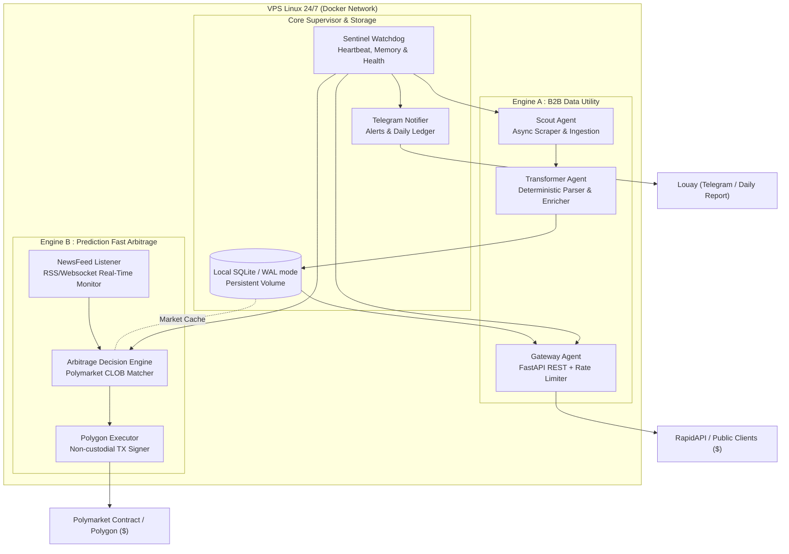

# Architecture Spine — Dual-Engine Autonomous Income Cluster

## 1. System Topology & Paradigm

Le système s'articule autour d'un paradigme **Event-Driven & Asynchronous Service Gateway**, conteneurisé sous Docker Compose, optimisé pour une exécution continue 24/7 sur un VPS Linux à ressources modérées (2-4 vCPU, 4 Go RAM).

---

## 2. Architecture Invariants & Decisions (AD)

### AD-1 : Stockage Local Embarqué (SQLite en mode WAL)
* **Binds :** Tous les agents partagent une base locale SQLite montée sur un volume persistant Docker.
* **Prevents :** Évite la dépendance et la surcharge d'un cluster PostgreSQL ou Redis lourd, consommant inutilement 1 Go de RAM.
* **Rule :** La base doit impérativement être configurée avec `PRAGMA journal_mode=WAL;` et `PRAGMA busy_timeout=5000;` pour supporter des écritures concurrentes et des lectures instantanées non-bloquantes.

### AD-2 : Isolation Déterministe vs LLM ($0 Marginal Cost)
* **Binds :** Ingestion, parsing, regex, validation de schéma et calculs mathématiques d'arbitrage sont 100 % déterministes en Python natif.
* **Prevents :** Élimine tout risque d'explosion de facture API LLM ou de blocage si une clé LLM expire.
* **Rule :** Un appel LLM (Gemini Flash ou Groq gratuit) n'est autorisé QUE pour la catégorisation sémantique ambiguë ou la détection de sentiment complexe, avec un cache LRU persistant.

### AD-3 : Sécurité Non-Custodial et Plafonnement Strict de Trésorerie
* **Binds :** Le module d'arbitrage Polymarket (Engine B) opère directement via une clé privée Polygon dérivée d'un sous-compte dédié à faible allocation (ex: 50 $ - 100 $ max).
* **Prevents :** Aucun risque de perte de capital supérieur à l'enveloppe allouée ; pas d'effet de levier ; zéro risque de liquidation.
* **Rule :** Chaque ordre d'arbitrage est plafonné à 20 $ maximum par marché. L'ordre n'est passé que si le spread garantit au minimum un gain net supérieur aux frais de gaz Polygon.

### AD-4 : Modularité des Composants & Couplage Faible
* **Binds :** Chaque moteur (Engine A, Engine B, Sentinel) s'exécute dans un conteneur ou un module Python asynchrone découplé.
* **Prevents :** Si le scraper de l'Engine A rencontre un timeout ou un changement de structure HTML, l'API Gateway et l'Engine B continuent de fonctionner sans interruption.
* **Rule :** Toutes les boucles d'ingestion utilisent des timeouts stricts (max 10s) et un mécanisme d'exponentiel backoff avec jitter.

### AD-5 : Mode Simulation / Dry-Run Natif
* **Binds :** L'intégralité du cluster supporte la variable d'environnement globale `SIMULATION_MODE=true`.
* **Prevents :** Permet de déployer et de valider à blanc tous les connecteurs, flux d'actualités et calculs de rentabilité sans dépenser le moindre centime réel.
* **Rule :** En mode simulation, les ordres Polymarket et les facturations API sont simulés dans le ledger local, générant les mêmes rapports Telegram journaliers.

### AD-6 : Interface d'Exposition API REST Standardisée
* **Binds :** L'Engine A expose une API FastAPI compatible avec les spécifications OpenAPI v3 et les proxys de facturation comme RapidAPI (`X-RapidAPI-Proxy-Secret`) ou direct `X-API-Key`.
* **Prevents :** Incompatibilité avec les places de marché de micro-services B2B.
* **Rule :** Les réponses sont systématiquement en JSON structuré avec temps de réponse < 50ms sur le cache chaud.

### AD-7 : Surveillance Sentinelle & Redémarrage Automatique
* **Binds :** Docker Compose orchestre les conteneurs avec `restart: always` et healthcheck périodique.
* **Prevents :** Mort silencieuse du cluster suite à un redémarrage impromptu du VPS ou une coupure réseau.
* **Rule :** Le watchdog envoie un signal de vie quotidien sur Telegram à 23h59 UTC avec le cumul des gains et alerte immédiatement en cas d'erreur de niveau CRITICAL.
