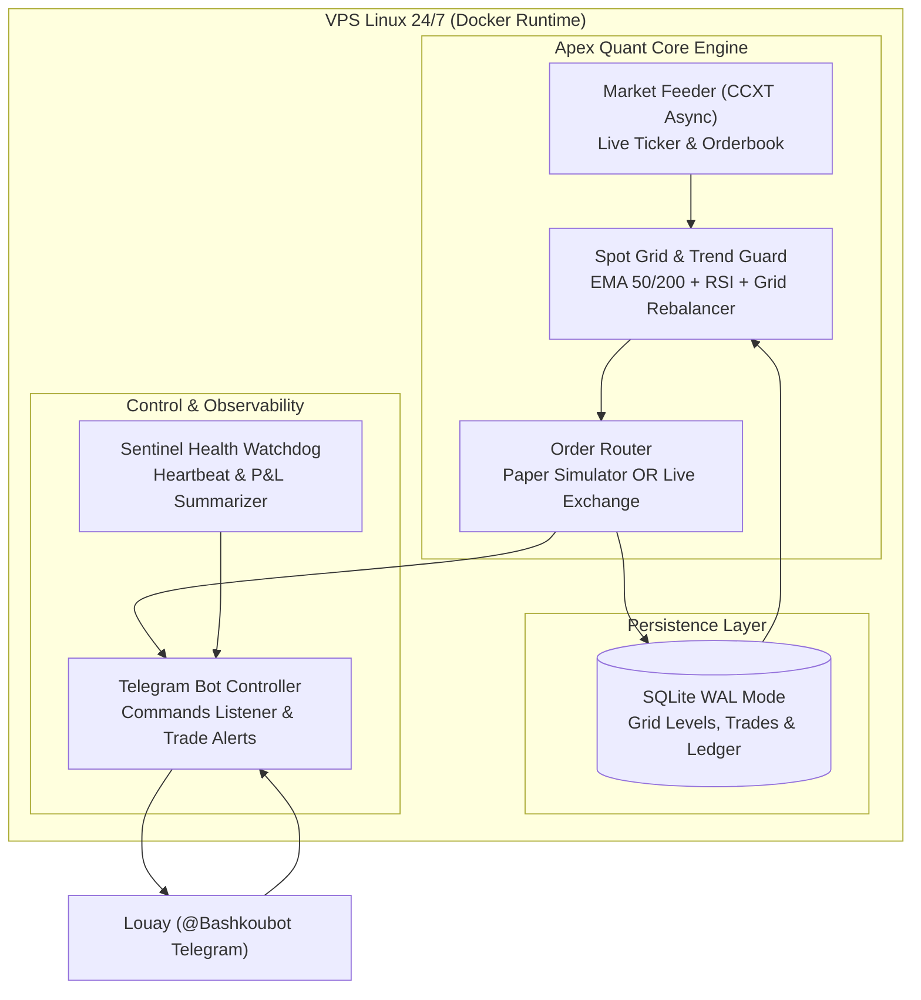

# Architecture Spine — Apex Quantitative Trading Agent

## 1. Topologie & Diagramme du Système

---

## 2. Invariants d'Architecture (AD)

### AD-1 : Moteur Asynchrone Haute Fréquence Non-Bloquant
* **Binds :** Tout le code utilise `asyncio` natif. Toutes les entrées/sorties réseau (CCXT, Telegram, base SQLite) sont non-bloquantes.
* **Prevents :** Évite que la vérification d'un ordre bloque l'écoute des commandes Telegram ou la surveillance des prix.
* **Rule :** Aucune opération synchrone `time.sleep()` ou appel HTTP bloquant n'est autorisé dans la boucle d'événements.

### AD-2 : Base de Données Embarquée SQLite WAL Mode
* **Binds :** Toutes les positions de grille, transactions et ordres sont écrits immédiatement dans `data/trading.db` avec `PRAGMA journal_mode=WAL;`.
* **Prevents :** Corruption de données en cas de redémarrage inopiné du VPS ou de coupure de courant.
* **Rule :** Au démarrage, le module `Reconciler` lit la base et restaure l'état exact des ordres avant de relancer les boucles.

### AD-3 : Exécution Hybride CCXT (Live Real-Money vs Live-Ticker Paper Trading)
* **Binds :** Le système supporte nativement deux modes d'exécution interchangeables via la variable `TRADING_MODE` (`paper` ou `live`) :
  - En mode `paper`, le bot interroge les vrais prix réels en direct de l'exchange (ex: Binance ou Bybit), simule les remplissages de carnet avec slippage et frais, et accumule de vrais métriques de P&L.
  - En mode `live`, le bot utilise les clés API réelles (`EXCHANGE_API_KEY`, `EXCHANGE_API_SECRET`) via CCXT pour placer de vrais ordres sur le marché Spot.
* **Prevents :** Impossibilité de tester sans risquer du capital immédiatement.
* **Rule :** Même logique stratégique stricte dans les deux modes, permettant une transition transparente.

### AD-4 : Terminal de Contrôle Telegram Bidirectionnel
* **Binds :** L'agent fait tourner un long-polling Telegram asynchrone intégré.
* **Prevents :** Nécessité d'ouvrir une session SSH sur le VPS pour vérifier l'état ou le profit du bot.
* **Rule :** L'agent écoute les messages venant uniquement de `TELEGRAM_CHAT_ID` (sécurité totale) et répond en quelques millisecondes aux commandes `/status`, `/balance`, `/profit`, `/pause`, `/resume`.

### AD-5 : Protection du Capital par Grid Dynamic Reseeding
* **Binds :** La grille calcule ses bornes supérieure et inférieure en fonction du prix d'entrée et de la volatilité moyenne (ATR).
* **Prevents :** Blocage de la grille si le cours sort durablement d'un intervalle fixe.
* **Rule :** Si le cours dépasse de plus de 10 % la borne haute, la grille se réajuste dynamiquement en sécurisant les profits déjà réalisés.
